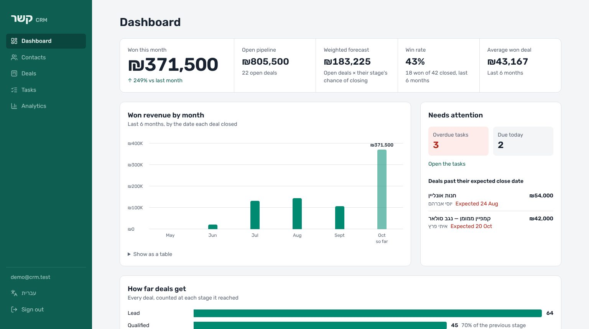
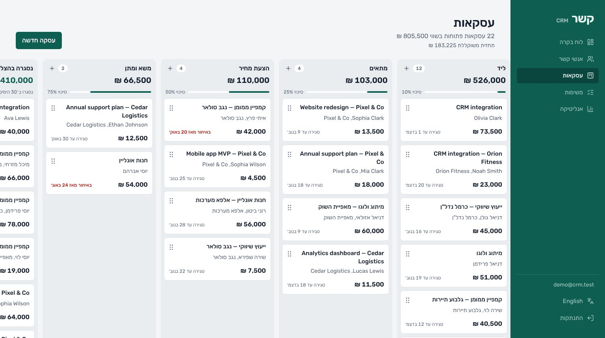
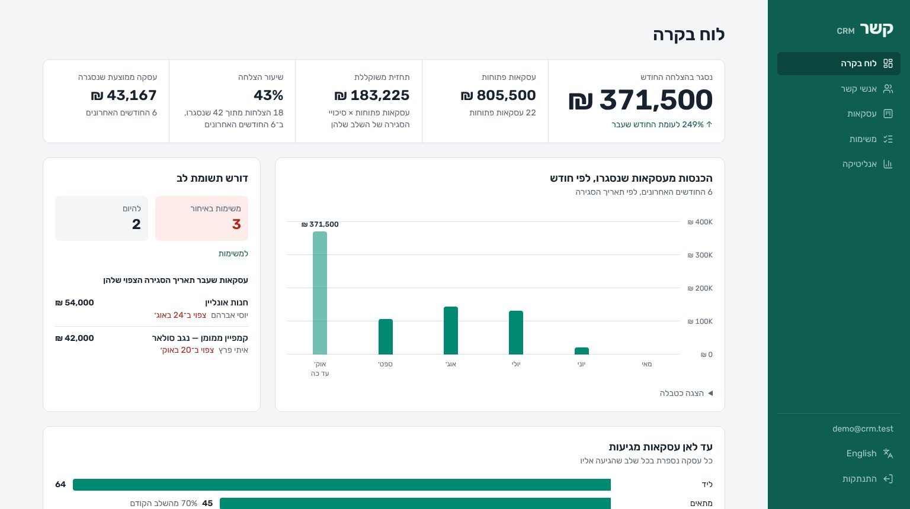
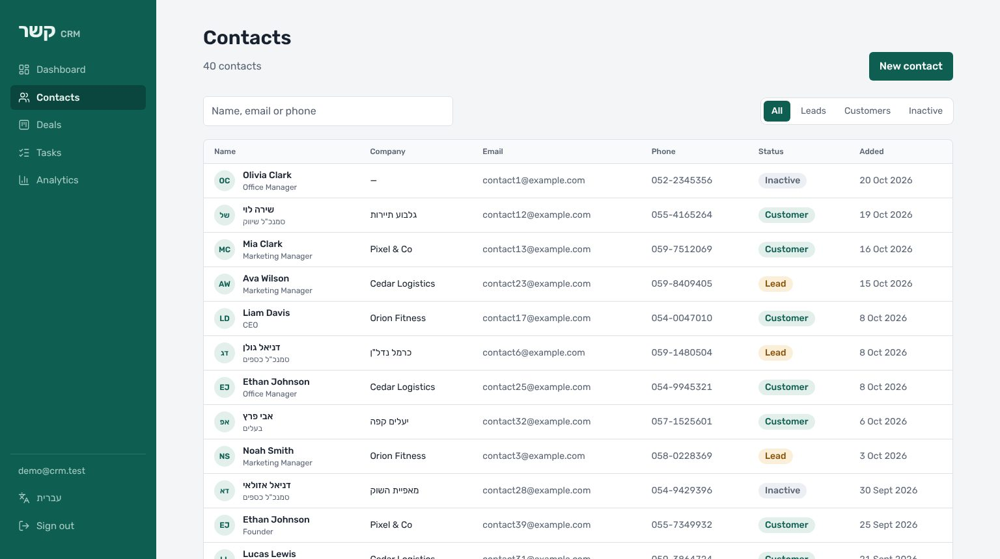
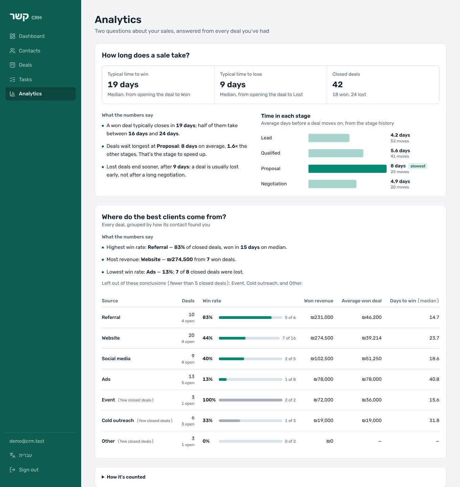

# Kesher (קשר) CRM

A bilingual (Hebrew / English) CRM for small businesses: contacts, a kanban sales pipeline, tasks, a KPI dashboard and an analytics section that answers business questions from the data.
Built as a portfolio project with Next.js 16 and Supabase.

**Live demo: https://kesher-crm-rose.vercel.app** — press *Open the demo account* (or *כניסה לחשבון הדגמה*); no sign-up needed.



| Deals board, Hebrew (right-to-left) | Dashboard, Hebrew |
|---|---|
|  |  |





The demo data is synthetic: about six months of a small agency's contacts and deals, generated with a few built-in patterns (referrals convert best, proposals are the slow stage) so the analytics have something to find.

> **Status:** all six planned steps are done, plus an **Analytics** section with written-up analyses in [`analysis/`](analysis/).

## What works today

- **Dashboard** (home page): won revenue this month vs last month, open pipeline, probability-weighted forecast, win rate and average won deal over 6 months; a month-by-month revenue chart with hover details and a table view; a funnel showing how far deals get; and what needs attention today (overdue tasks, deals past their close date).
- **Hebrew and English** with a full right-to-left layout. Language lives in the URL (`/he/…`, `/en/…`), is detected from the browser on first visit and remembered.
- **Sign-in** with email and password, plus a one-click **demo account** (credentials stay on the server).
- **Contacts**: list with search (name, email, phone — in either language), status filter, pagination, create / edit / delete in a dialog, with validation messages in both languages.
- **Contact page**: details, the contact's deals, their tasks (tick off, add, delete) and an activity timeline that mixes logged notes, calls, emails and meetings with automatic entries for every move of their deals through the pipeline.
- **Tasks**: every open task grouped into Overdue, Today, Next 7 days, Later and No due date, linked to its contact and deal; tick off, add (optionally for a contact), delete; a Completed view.
- **Deals board (kanban)**: drag deals between stages with mouse, touch or keyboard. Each column shows its total and the stage's chance of closing; the header shows the pipeline value and the probability-weighted forecast. Moves appear instantly and roll back if the save fails. Won / Lost show the last 30 days. Screen reader announcements in both languages.
- **Analytics**: answers two questions — *how long does a sale take?* (median time to win or lose, time in each stage from the stage history, the slowest stage) and *where do the best clients come from?* (deals, win rate, revenue and days to win per lead source). The page states its findings as sentences in both languages, computed from the live data, and draws no conclusion from fewer than 5 deals.
- **Analysis write-ups** in [`analysis/`](analysis/): question → metric definition → SQL → findings → recommendations → limits, for each question.
- **Self-healing demo**: a `pg_cron` job rebuilds the shared demo account every night, so a visitor who deletes everything doesn't break it for the next one.
- **Security in the database**, not just the UI: Row Level Security on every table, composite foreign keys so no one can link to another user's records, owner set by the database from the session.

## Stack

| Layer | Choice |
|---|---|
| App | Next.js 16 (App Router, Server Components, Server Actions, Cache Components), React 19, TypeScript |
| Styling | Tailwind CSS 4, logical properties (`ms-`, `text-start`) so one stylesheet serves RTL and LTR |
| Data & auth | Supabase (PostgreSQL 15+, Auth, RLS) via `@supabase/ssr` |
| Drag and drop | dnd-kit (mouse, touch and keyboard sensors) |
| Validation | Zod |
| Font | Rubik — one family that covers Hebrew and Latin |

## Project layout

```
supabase/
  migrations/        schema, RLS, triggers, dashboard views, demo data generator
  tests/             SQL tests: user isolation, composite keys, triggers, views
web/
  src/proxy.ts       language routing + session refresh + route protection
  src/i18n/          locales, dictionaries (he.json / en.json)
  src/lib/supabase/  server and proxy clients
  src/lib/data/      data access (runs as the signed-in user)
  src/app/[locale]/  pages: login, dashboard, contacts, contact page, deals, tasks, analytics
analysis/            business questions answered with SQL: findings and recommendations
```

## Run it locally

1. **Supabase project.** Create one at supabase.com. In the SQL Editor run the files in `supabase/migrations/` in order (the third one schedules a nightly reset of the demo account with `pg_cron`; change the demo email in it if yours differs; the fourth adds the analytics views).
2. **Demo user.** Authentication → Users → Add user (e.g. `demo@yourdomain.com`, auto-confirm). Then in the SQL Editor:
   ```sql
   select public.seed_demo_data((select id from auth.users where email = 'demo@yourdomain.com'));
   ```
3. **Environment.** Copy `web/.env.example` to `web/.env.local` and fill in the project URL, publishable key and the demo credentials.
4. **Start.**
   ```bash
   cd web
   npm install
   npm run dev
   ```
   Open http://localhost:3000.

## Deploy

Import the repo into Vercel with **Root Directory = `web`**, add the same four environment variables, deploy. `web/vercel.json` pins the server functions to Frankfurt (`fra1`), next to the Supabase database; change it if your database lives elsewhere. In Supabase → Authentication → URL Configuration add the Vercel URL as the Site URL.

## Design decisions worth reading

- `supabase/README.md` explains the schema and why the foreign keys are composite.
- `web/src/proxy.ts` — one place decides language and access before a page renders.
- `web/src/lib/supabase/server.ts` — why the Supabase client calls `connection()` under Cache Components.
- `web/src/app/[locale]/(app)/contacts/actions.ts` — Server Actions return error *codes*; the form translates them, so the server stays language-free.
- `web/src/app/[locale]/(app)/contacts/[id]/contact-detail-view.tsx` — the timeline is built on the server from two sources (logged activities and the stage-history table the database trigger fills), with every date formatted in Israel's time zone so the browser can't disagree.
- `web/src/lib/data/dashboard.ts` — every dashboard number comes from a database view, so "open", "won" and "forecast" mean the same thing on the board, the contact page and the dashboard.
- `web/src/lib/time.ts` — "today" and "overdue" are decided in Israel's time zone, including the summer-time switch.
- `supabase/migrations/20261025000300_analytics.sql` — time in stage with `LEAD() OVER (PARTITION BY deal_id …)`, medians with `percentile_cont`, conversion by source with `count(*) filter (…)`; and a demo-data generator whose timelines are always consistent.
- `web/src/lib/analytics-insights.ts` — the rules that turn numbers into findings (slowest stage, best and worst source, minimum sample) in one pure function, separate from the page.
- `web/src/app/[locale]/(app)/deals/deals-board.tsx` — optimistic drag and drop: a moved card gets a position halfway between its neighbours, so one row is written per move; the database trigger logs the stage change and stamps the close date.

## Roadmap

1. ~~Database schema, RLS, demo data~~
2. ~~Bilingual app shell, sign-in, contacts~~
3. ~~Deals kanban with drag and drop (dnd-kit), stage history~~
4. ~~Contact page with timeline (activities, tasks)~~
5. ~~Tasks list with due dates~~
6. ~~Dashboard: pipeline value, weighted forecast, win rate, funnel~~
7. ~~Analytics: sales cycle, time in stage, lead-source performance~~
8. Next ideas: forecast accuracy, reasons for lost deals, CSV import / export, CI
