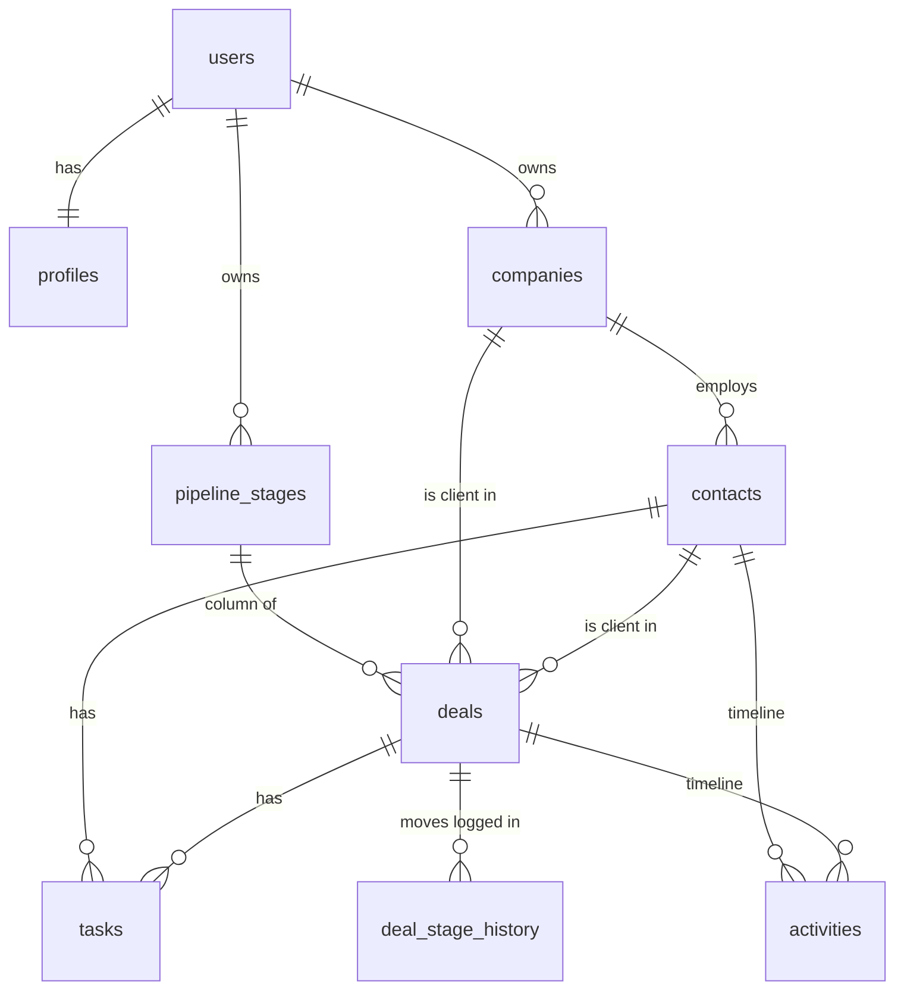

# CRM — database (Supabase / PostgreSQL)

## Schema



| Table | Purpose |
|---|---|
| `profiles` | One per user: name, UI language (`he` / `en`), currency |
| `companies`, `contacts` | Clients |
| `pipeline_stages` | Kanban columns. Defaults have a `key` the UI translates; custom ones have a `name` |
| `deals` | Kanban cards: amount, stage, client, order inside the column |
| `deal_stage_history` | Every move between stages — written by a trigger, read-only for users |
| `tasks` | To-dos with due date and priority, linked to a deal or contact |
| `activities` | Notes, calls, emails, meetings on the contact / deal timeline |

Dashboard views: `pipeline_summary` (count, total and probability-weighted forecast per stage), `monthly_sales` (won revenue, win rate, average deal), `funnel` (how far deals get).

Analytics views: `closed_deals` (one row per won or lost deal with its cycle length and lead source), `sales_cycle_summary` (median and middle-half days to win and to lose), `stage_durations` (time in each stage, from the stage history with `LEAD() OVER (PARTITION BY deal_id …)`), `source_performance` (deals, win rate, revenue and days to win per lead source).

## Design decisions

- **Row Level Security everywhere.** Every row has `owner_id`, filled automatically from `auth.uid()`. Policies let a user see and change only their own rows.
- **Composite foreign keys `(id, owner_id)`.** RLS alone does not stop a user from linking their deal to someone else's contact if they know its id — foreign-key checks ignore RLS. Composite keys make that impossible at the database level.
- **`on delete set null (contact_id)`** (PostgreSQL 15+) clears only the link column, not `owner_id`.
- **Triggers, not app code, own the business rules:** a new user gets a profile and default pipeline; moving a deal to Won/Lost stamps `closed_at`; every stage change is logged for analytics.
- **Views use `security_invoker`**, so dashboards respect RLS.
- **Bilingual by design:** UI text is translated from stage keys; user data is stored as typed, so Hebrew and English sit side by side.

## Setup

1. Create a Supabase project.
2. Run the files in `migrations/` in order (SQL Editor, or `supabase db push` with the CLI).
3. Create a demo user (Authentication → Users → Add user), then in the SQL Editor:
   ```sql
   select public.seed_demo_data((select id from auth.users where email = 'demo@yourdomain.com'));
   ```
   This fills the account with ~6 months of synthetic data: 12 companies, 40 contacts, 64 deals, tasks and activities. Every timeline is consistent (a deal starts after its contact, stages pass in order, nothing is in the future), and a few patterns are built in for the analytics: referrals convert best, ads worst, and proposals are the slow stage. Run it again any time to reset the demo; the nightly `pg_cron` job does this for the shared demo account.

## Tests

`tests/` runs the migrations on plain PostgreSQL with a small Supabase Auth stub and checks isolation between users, the composite keys, the stage triggers and the views. `analytics_test.sql` checks that the demo timelines are consistent, that the analytics views match hand counts, and that no one sees another user's analytics. (The `pg_cron` migration needs Supabase and is skipped here.)

```bash
psql -d crm_test -f tests/supabase_stub.sql \
  -f migrations/20261025000000_init_schema.sql \
  -f migrations/20261025000100_demo_data.sql \
  -f migrations/20261025000300_analytics.sql \
  -f tests/rls_test.sql \
  -f tests/analytics_test.sql
```
